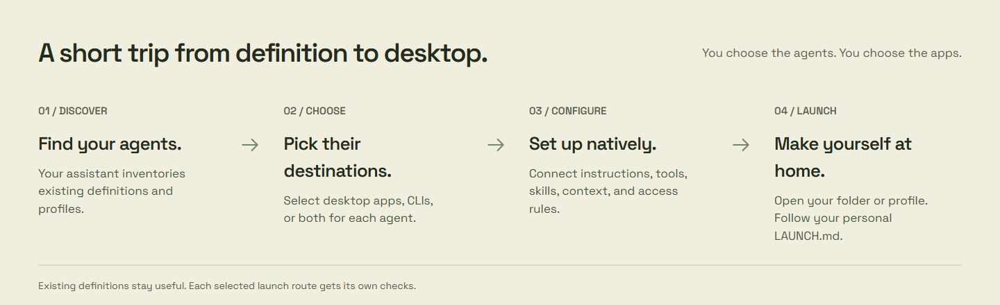
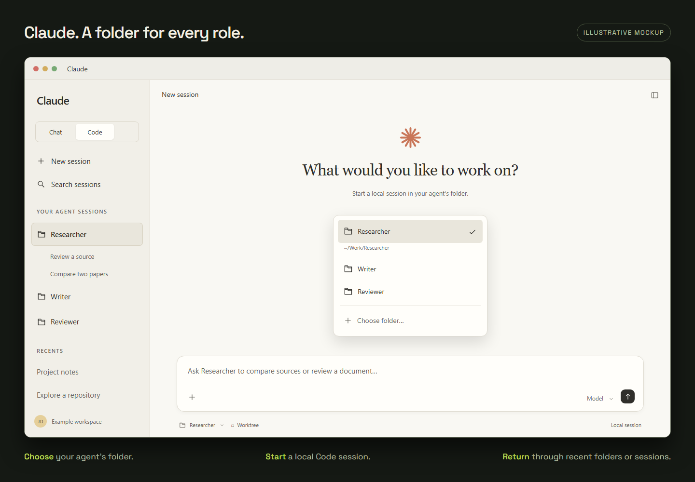
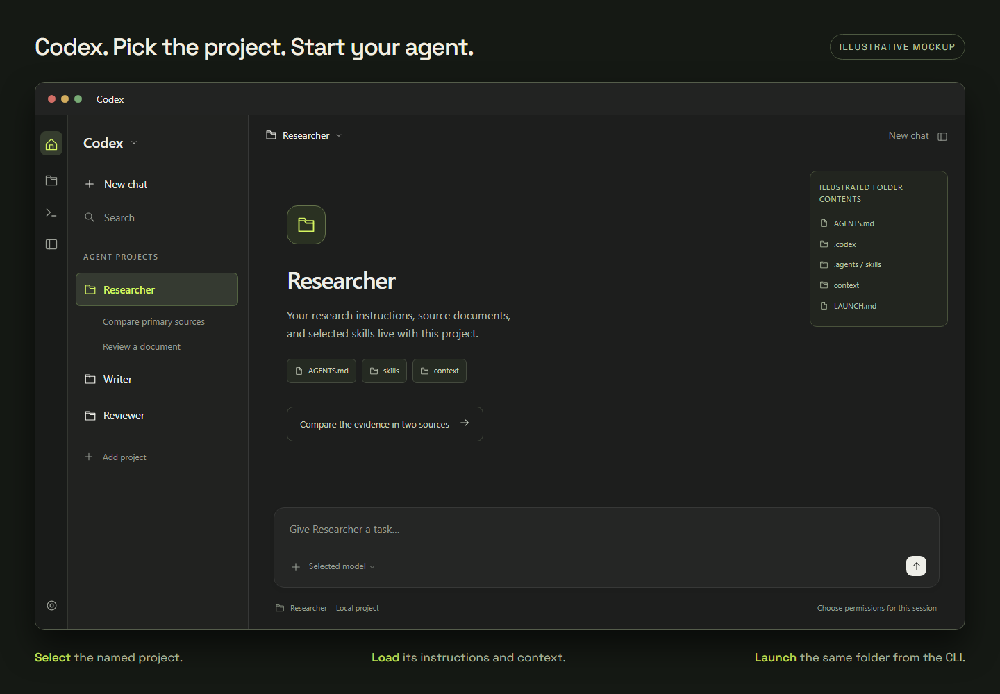

<picture>
  <source media="(prefers-reduced-motion: reduce)" srcset="assets/readme/hero-static.webp">
  
</picture>

  <a href="#get-started"><strong>Get started</strong></a>
  &nbsp; · &nbsp;
  <a href="#see-agent-folder-views">See folder examples</a>
  &nbsp; · &nbsp;
  <a href="#choose-your-apps">Choose your apps</a>
  &nbsp; · &nbsp;
  <a href="VERIFICATION.md">Verification</a>

# Custom agents. Familiar apps.

Give your custom agents a place in Claude Code, Codex, Cursor, Hermes, T3 Code, or Grok Build. Choose desktop, CLI, or both. Your assistant handles the native setup and writes your personal launch guide.

Bring an existing agent, a set of instructions, or a definition someone shared with you. Keep its role, skills, context, and requested access together. Each app's supported controls determine the effective permissions.

## Get started

Give your AI assistant this repository and this request:

> Read SETUP.md. Inventory my existing custom agents and subagents, show me what you found, and ask which ones I want in which desktop apps or CLIs. Set them up using each app's native configuration and give me a short launch guide.

Your assistant inventories first, helps you choose destinations, and uses native configuration locations or a custom location suited to your machine. Existing native definitions can remain your source. The [agent template](templates/AGENT.md) is available for creating or sharing one.

[Start the guided setup](SETUP.md) · [Check your operating system](PLATFORMS.md)

<picture>
  <source media="(max-width: 600px)" srcset="assets/readme/setup-flow-mobile.webp">
  
</picture>

## See agent folder views

Select a named project or folder, then start a session with that agent's instructions and context. Hermes uses its native profile and optional Bot Mode entry.

*The images below are illustrative mockups with fictional Researcher, Writer, and Reviewer agents. Layouts and controls vary by app version. Native setup steps and observed results are linked separately.*

### Claude Code: open the agent's folder

Use Claude Desktop's Code tab to open the configured folder for a local session. Return through recent folders or sessions.

[Set up Claude Code →](surfaces/claude-code.md)

### Codex: give the agent a project

Add the configured folder as a project. Select it in the sidebar and start a local chat. The companion CLI uses the same folder.

[Set up Codex →](surfaces/codex.md)

## Choose your apps

Choose a destination for each agent. Desktop and CLI access can be configured independently.

| Desktop app | CLI companion | Native setup |
|---|---|---|
| Claude Desktop, Code tab | Claude Code | [Claude guide](surfaces/claude-code.md) |
| Codex, including its location in the ChatGPT desktop app | Codex CLI | [Codex guide](surfaces/codex.md) |
| Cursor | Cursor Agent CLI | [Cursor guide](surfaces/cursor.md) |
| Hermes Desktop | Hermes CLI | [Hermes guide](surfaces/hermes.md) |
| T3 Code | Each selected provider's CLI | [T3 guide](surfaces/t3-code.md) |
| A supporting desktop host for Grok | Grok Build | [Grok guide](surfaces/grok.md) |

**Windows, macOS, and Linux:** [platform preparation](PLATFORMS.md) covers installation sources, supported packages, configuration homes, shells, and dependencies. App availability and model access follow the vendor, OS, architecture, and your account.

## What stays with the agent

| Part of the setup | What your assistant carries forward |
|---|---|
| Instructions and context | The agent's role, existing imports, and the documents it needs |
| Tools and skills | Declared MCP connections, selected skills, and agent-owned data paths where needed |
| Access rules | The requested file, shell, and MCP restrictions, checked against each app's actual controls |
| Launch instructions | A personal `LAUNCH.md` with exact desktop steps, CLI commands, native paths, and installation results |

Provider, model, and effort choices stay explicit for each route. Existing settings are preserved and merged. Your launch guide names incomplete capabilities and any effective permission differences.

## Share an agent. Let someone else choose the destination.

Share its instructions and the skills and context you have permission to distribute. Include its requested tools and access rules, with credential references kept separate from secret values. Give the recipient this repository link.

Their assistant follows the same setup on their own machine. An SEO agent shared with a colleague on a Mac is one example; research, writing, review, and other roles use the same guided process.

## Know what has been checked

[Verification](VERIFICATION.md) separates historical working deployments, disposable fixture checks, current vendor documentation, and remaining runtime gaps. The guides cover Windows, macOS, and Linux. Native macOS and Linux execution remains unverified in this project.

Your installing assistant checks the selected launch routes and reports each required capability's result. File permissions, shell access, inherited tools, and MCP mutations receive separate checks.

## Keep the setup yours

Update the agent from its recorded source and ask your assistant to rerun the selected setup. Existing working folders, native profile names, unrelated project instructions, and account settings are preserved.

| Reference | Purpose |
|---|---|
| [SETUP.md](SETUP.md) | Guided installation instructions for your assistant |
| [PLATFORMS.md](PLATFORMS.md) | Windows, macOS, and Linux preparation |
| [SPEC.md](SPEC.md) | Existing sources, the optional portable format, and native output |
| [Templates](templates/) | Optional agent definition and personal launch guide |
| [Fictional example](examples/bob/) | Read-only sample definition and disposable fixture |
| [VERIFICATION.md](VERIFICATION.md) | Observed behavior and open checks |
